# Memoni

Memoni (MEMOry MONItor) is a fast, keyboard-driven, visually minimal clipboard manager for X11.

<p align="center">
  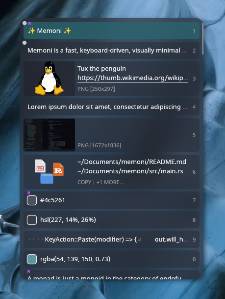
</p>

## Features

### Everything captured

Text, rich text, images, files, anything. Data of every MIME type is kept and pasted back intact (except your
passwords[*](#sensitive-content) of course, don't worry).

<p align="center">
  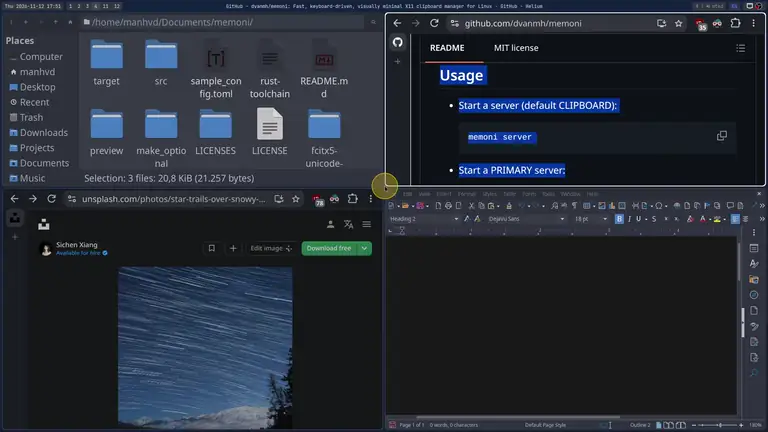
</p>

### Vim and Emacs inspired keymaps

Vim-style navigation in normal mode, Emacs-style editing in the search prompt.

<p align="center">
  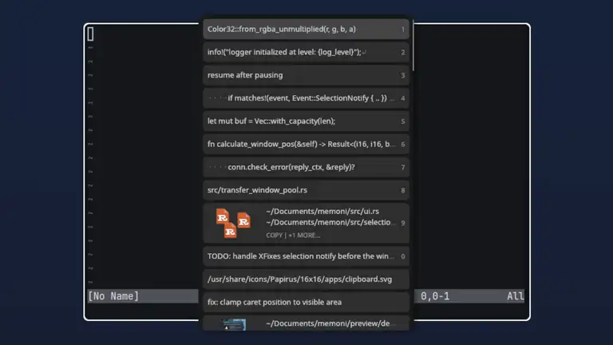
</p>

### Search

Filter clipboard history with plain, fuzzy, or regex search.

<p align="center">
  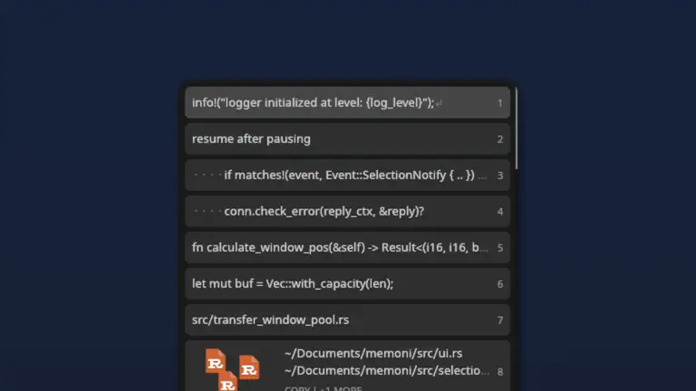
</p>

### Automatic pasting

Selecting an item pastes it automatically with `Ctrl+V`, or with a custom keymap configured per application.

<p align="center">
  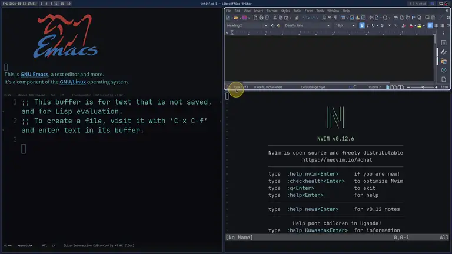
</p>

For the PRIMARY selection, the item is pasted by middle-clicking at the pointer position instead (not configurable).

<p align="center">
  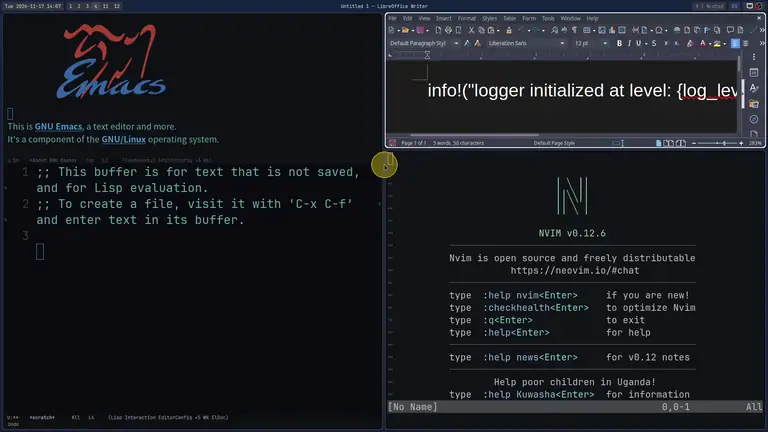
</p>

### Pins and bookmarks

Save items by pinning them to the top of the history, or bookmarking them to a dedicated list.

<p align="center">
  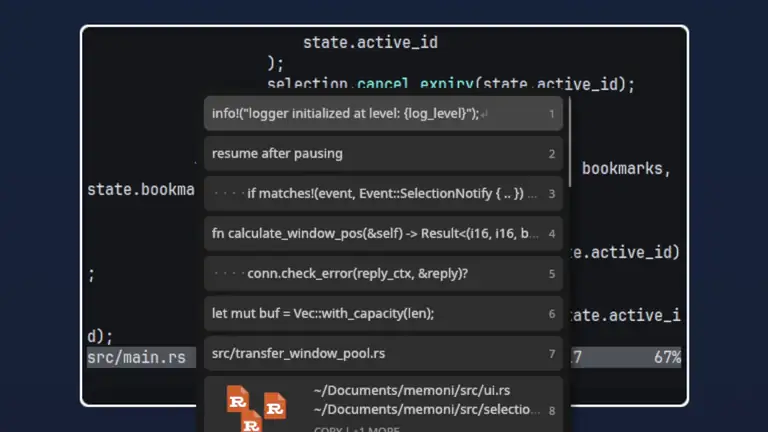
</p>

### Flexible window placement

Show the window centered in the focused monitor, next to the pointer, or next to the text caret.

<p align="center">
  <table>
    <tr>
      <td align="center" valign="top" width="50%">
        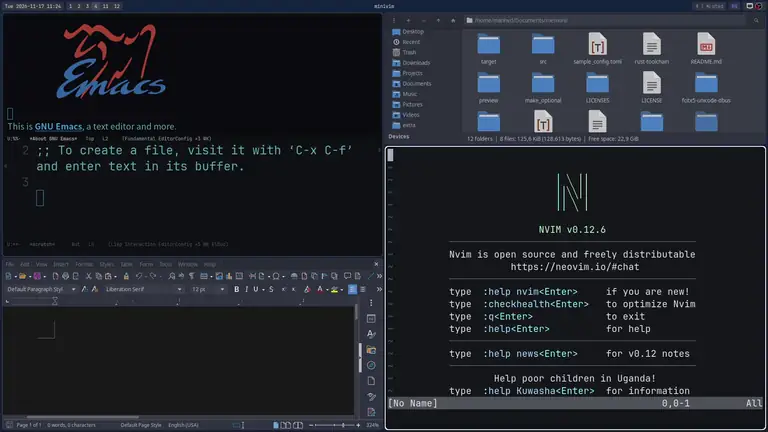
        <br />
        <code>monitor</code>
        <br />
        <small>Centered in the focused monitor</small>
      </td>
      <td align="center" valign="top" width="50%">
        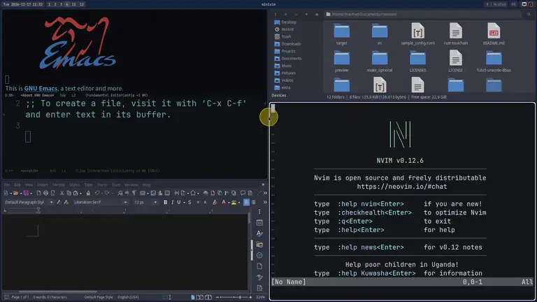
        <br />
        <code>pointer</code>
        <br />
        <small>Always next to the pointer</small>
      </td>
    </tr>
    <tr>
      <td align="center" valign="top" width="50%">
        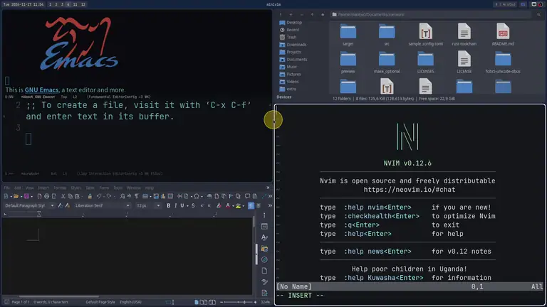
        <br />
        <code>active_pointer</code> → <code>monitor</code>
        <br />
        <small>Next to the pointer only when it's visible on the focused monitor, otherwise centered in the focused monitor</small>
      </td>
      <td align="center" valign="top" width="50%">
        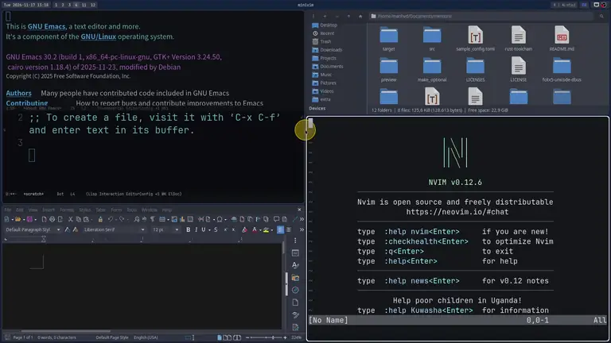
        <br />
        <code>text_caret</code> → <code>monitor</code>
        <br />
        <small>Next to the caret of the focused input field, otherwise centered in the focused monitor</small>
      </td>
    </tr>
  </table>
</p>

### Sensitive content

Content marked as secret by password managers (`x-kde-passwordManagerHint`) is ignored automatically.

Content can also be ignored by clipboard owner window (`ignore_windows`), clipboard owner process (`ignore_processes`),
or content itself (`ignore_contents`) (see [sample_config.toml](./sample_config.toml) for details).

Some password managers that don't set `x-kde-passwordManagerHint` (e.g., `pass`, `keepassxc-cli`) shell out to `xclip`
and similar tools for clipboard access, so the owner window has no class and the owner process can't be traced back to
the real app. For those, use the [pausing feature](#pausing) instead.

## Building

Requirements:

- Linux/X11 with OpenGL/EGL
- fontconfig (only if using custom fonts)

```sh
cargo build --release
```

## Usage

### Server

Start a server (default CLIPBOARD):

```sh
memoni server
```

Start a PRIMARY server:

```sh
memoni server --selection PRIMARY
```

### Window

Show the window:

```sh
memoni
```

```sh
memoni --selection PRIMARY
```

Press `?` in the window to view the full keymap list.

### Pausing

Pause capture:

```sh
memoni pause           # follows `pause_auto_resume_after` config (default: paused forever)
memoni pause 30m       # auto-resume in 30 minutes
memoni pause inf       # never auto-resume (until `memoni pause resume`)
memoni pause next      # resumes after the next 1 clipboard change
memoni pause next 3    # resumes after the next 3 clipboard changes
```

Resume capture:

```sh
memoni pause resume
```

Check the pause state:

```console
$ memoni pause state
not paused
$ memoni pause 30m
paused (auto-resume in 30m)
$ memoni pause state
paused (auto-resume in 29m50s)
```

### Help

For full command and option details, run:

```sh
memoni --help
memoni server --help
```

## Configuration

Customize the behavior and appearance via the configuration file at `$XDG_CONFIG_HOME/memoni/config.toml`. Note that the
application does not automatically create this file; it must be created manually.

See [sample_config.toml](./sample_config.toml) for a complete list of options and examples.

## Credits

- [Noto Sans](https://fonts.google.com/noto/specimen/Noto+Sans) (SIL Open Font License)
- [Noto Sans Math](https://fonts.google.com/noto/specimen/Noto+Sans+Math) (SIL Open Font License)
